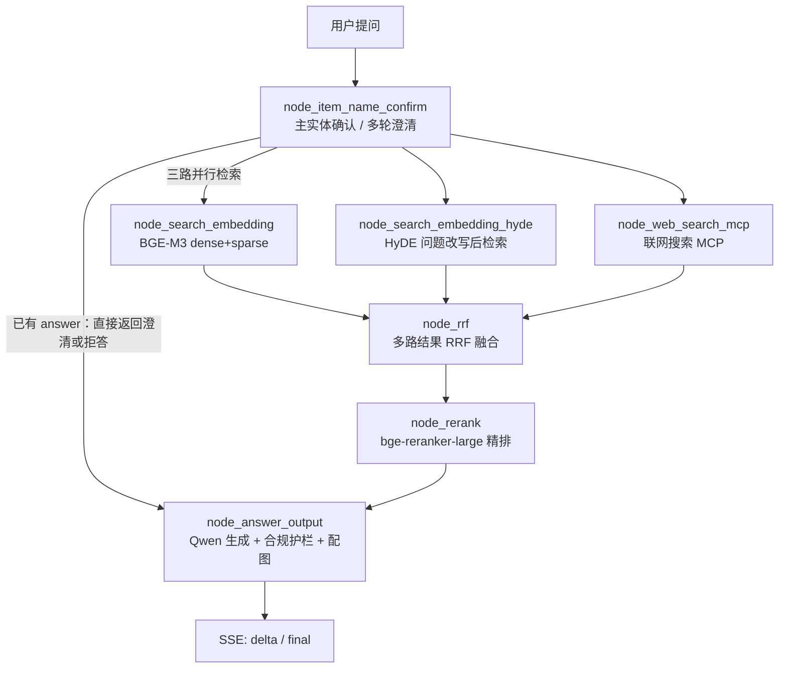
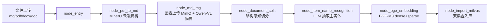
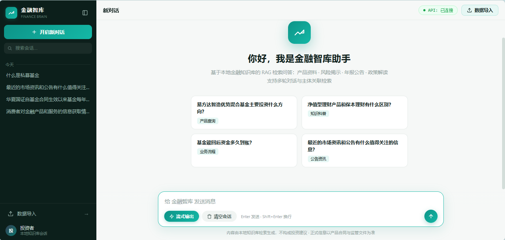
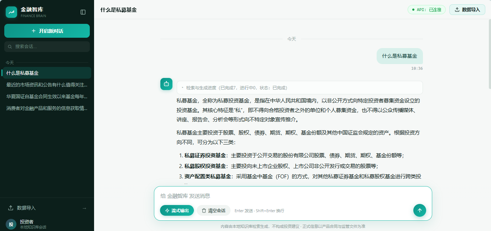
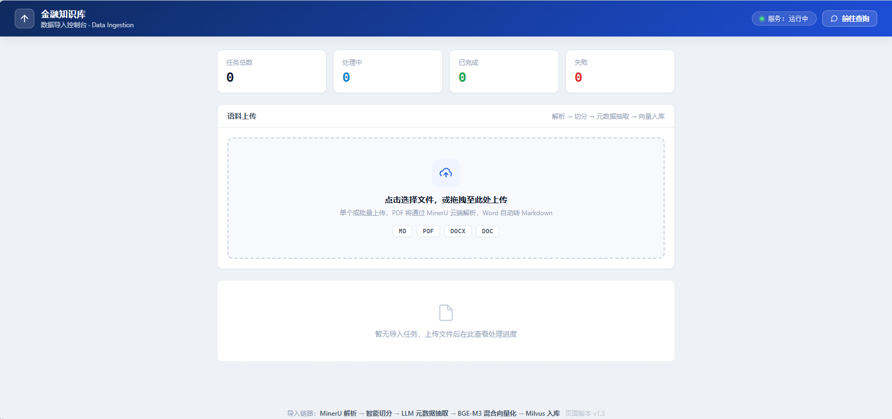

# Finance-Brain · 金融知识库智能问答系统

> 面向金融研报/基金文档的 RAG 问答系统：LangGraph 编排两条链路（导入 / 查询），BGE-M3 混合检索 + bge-reranker 精排 + Qwen 流式生成，带 SSE 进度推送、多轮会话与 Langfuse 全链路追踪。

Python 3.12 · LangGraph · FastAPI · Milvus · BGE-M3 · bge-reranker-large · MongoDB · MinIO · Langfuse

---

## 1. 项目定位

金融文档（货币政策报告、基金产品概要、风险揭示书等）有三个特点：篇幅长、术语与代码密集（基金代码、政策文号）、对准确性要求高。直接把整篇塞进大模型既贵又容易答错。

本项目的目标是把这类文档做成可检索、可追溯的知识库：

- **导入侧**：把 MD / PDF / DOCX / DOC 解析、切分、抽取主实体、向量化后写入 Milvus；
- **查询侧**：先确认问的是哪只基金/哪家机构，再三路召回（稠密、HyDE、联网）融合重排，最后基于检索片段生成带配图的回答；
- **可观测**：每个请求的节点耗时、LLM token 用量都能在 Langfuse 里逐层下钻，性能问题可以被定位到具体节点而不是"整体慢"。

---

## 2. 整体架构

### 2.1 查询链路（端口 8002）



- 三路检索是**并行**的（LangGraph 条件边扇出），汇流到 `node_rrf` 后统一精排；联网这路最慢时会把整条链路拖住。
- 主实体确认阶段如果无法确定问的是哪个产品，会直接跳到答案节点给出澄清话术，不进入检索。
- 检索片段与回答都以 SSE 增量推送给前端。

### 2.2 导入链路（端口 8003）



导入任务异步执行，前端通过 `/status/{task_id}` 轮询进度。

### 2.3 各组件的实际角色

| 组件 | 角色 |
|---|---|
| **Milvus** | 向量库。`finance_chunks` 存切片向量（dense + sparse），`finance_product_names` 存主实体名（用于实体确认时召回候选），`finance_entities` 预留 |
| **MongoDB** | 会话与消息存储（`finance_kb.chat_message`），支撑多轮上下文、会话列表（聚合管道 `$group + $first/$min/$max`）与历史回放 |
| **MinIO** | 对象存储。PDF 中抽取的图表上传后返回 URL，供回答配图与前端展示 |
| **BGE-M3** | 本地向量模型，单模型同时产出稠密与稀疏向量；稀疏通道负责基金代码、政策文号这类精确 token |
| **bge-reranker-large** | 本地精排模型，对 RRF 融合后的候选逐对打分；当前为 CPU fp32 推理，是单请求最大耗时项（见第 7 节） |
| **Qwen（DashScope）** | `qwen-flash` 负责实体抽取、HyDE 改写、答案生成；`qwen-vl-plus` 负责图表理解 |
| **MinerU（云端）** | PDF → Markdown，保留标题层级与图表位置 |
| **Langfuse** | 链路追踪。按 trace 记录每个节点与每次 LLM 调用的耗时、token 与 metadata |

---

## 3. 目录结构

```
finance-brain/
├── api/
│   ├── query_service.py          # 查询服务 8002：/query /stream/{sid} /history /sessions /health
│   └── file_import_service.py    # 导入服务 8003：/upload /status/{task_id} /health
├── processor/
│   ├── query_processor/
│   │   ├── main_graph.py         # 查询图：条件路由 + 三路并行 + RRF 汇流
│   │   ├── state.py              # 图状态定义
│   │   └── nodes/                # 7 个查询节点（实体确认/两路检索/联网/RRF/精排/答案）
│   └── import_processor/
│       ├── main_graph.py         # 导入图：解析 → 切分 → 实体 → 向量化 → 入库
│       └── nodes/                # 7 个导入节点
├── utils/
│   ├── clients/                  # Milvus / MongoDB / MinIO 客户端封装
│   ├── lm/                       # LLM / Embedding / Reranker 封装（含模块级单例）
│   ├── langfuse_utils.py         # 追踪客户端、回调、trace 上下文、退出前 flush
│   ├── sse_utils.py              # SSE 队列与事件生成（delta / final / error）
│   ├── task_utils.py             # 任务状态机（进度 / 完成 / 失败）
│   └── compliance_utils.py       # 合规护栏：禁用词、风险提示、范围外拒答
├── common/
│   ├── config/                   # 各组件配置（从 .env 读取）
│   └── logging/                  # loguru 统一日志（控制台 + 文件，按天保留）
├── page/                         # 前端：chat.html / import.html（原生 HTML+JS，零构建）
├── eval/                         # 检索与回答评估脚本（含 RAGAS）
├── docs/images/                  # README 界面截图（真实运行截图）
├── perf_trace/                   # 链路追踪与压测产物（见第 7 节）
└── pyproject.toml                # uv 依赖管理
```

---

## 4. 环境要求与快速开始

### 4.1 环境要求

- **Python 3.12**（`requires-python = "==3.12.*"`），依赖用 [uv](https://docs.astral.sh/uv/) 管理
- **Windows x64**：`pyproject.toml` 里通过 `required-environments` 限定了 win32/AMD64，并依赖 `pywin32`
- **外部依赖服务**：Milvus（含索引服务）、MongoDB、MinIO，以及可访问的 DashScope / MinerU / Langfuse
- **本地模型**：BGE-M3 与 bge-reranker-large，默认放本地目录（路径在 `.env` 指定）

### 4.2 安装与启动

```bash
# 1) 安装依赖
uv sync

# 2) 配置环境变量
cp .env.example .env      # 按 4.3 填真实值，.env 已在 .gitignore 中

# 3) 下载本地模型（首次）
python utils/download_model/download_bgem3.py
python utils/download_model/download_reranker.py

# 4) 启动两个服务（各自一个终端，8002 首次启动约 25s）
python api/query_service.py          # 查询服务 → http://127.0.0.1:8002/chat.html
python api/file_import_service.py    # 导入服务 → http://127.0.0.1:8003/import.html
```

启动后用 `http://127.0.0.1:8002/health` 确认返回 `{"ok": true}`；未配置 Langfuse 密钥时服务照常启动，只打印一条告警。

### 4.3 `.env` 变量说明

| 分组 | 变量 | 含义 |
|---|---|---|
| MinerU | `MINERU_API_TOKEN` / `MINERU_BASE_URL` | PDF 解析的云端 API 凭证与地址 |
| LLM / VLM | `OPENAI_API_KEY` / `OPENAI_BASE_URL` | DashScope 的 OpenAI 兼容接口（默认 `dashscope.aliyuncs.com/compatible-mode/v1`） |
| | `LLM_DEFAULT_MODEL` / `VL_MODEL` / `LLM_DEFAULT_TEMPERATURE` | 默认 `qwen-flash` / `qwen-vl-plus` / `0.1` |
| Milvus | `MILVUS_URL` | 向量库地址，如 `http://192.168.10.8:19530` |
| | `CHUNKS_COLLECTION` / `ITEM_NAME_COLLECTION` / `ENTITY_NAME_COLLECTION` | 切片集合 / 主实体集合 / 预留实体集合 |
| MongoDB | `MONGO_URL` / `MONGO_DB_NAME` | 会话与消息存储（默认库 `finance_kb`） |
| MinIO | `MINIO_ENDPOINT` / `MINIO_ACCESS_KEY` / `MINIO_SECRET_KEY` / `MINIO_BUCKET_NAME` | 图表对象存储 |
| | `MINIO_IMG_DIR` / `MINIO_SECURE` | 图片目录前缀 / 是否走 TLS |
| BGE-M3 | `BGE_M3_PATH` / `BGE_M3` | 本地模型目录 / 模型标识 |
| | `BGE_DEVICE` / `BGE_FP16` | 推理设备（`cpu` 或 `cuda:0`）/ 是否半精度 |
| Rerank | `BGE_RERANKER_LARGE` | 模型目录 |
| | `BGE_RERANKER_DEVICE` / `BGE_RERANKER_FP16` | 推理设备 / 是否半精度（当前为 `cpu` + `0`） |
| 联网 | `MCP_DASHSCOPE_BASE_URL` | WebSearch MCP 地址（可选，不可用时该路检索降级） |
| Langfuse | `LANGFUSE_BASE_URL` / `LANGFUSE_PUBLIC_KEY` / `LANGFUSE_SECRET_KEY` | 填虚拟机或服务端的**可达 IP**（不要写 `0.0.0.0`），密钥来自 Langfuse 项目设置 |
| 日志 | `LOG_CONSOLE_ENABLE/LEVEL` / `LOG_FILE_ENABLE/LEVEL` / `LOG_FILE_RETENTION` | 控制台与文件日志开关、级别、保留天数 |

### 4.4 主要接口

| 服务 | 方法 & 路径 | 说明 |
|---|---|---|
| 8002 | `POST /query` | 入参 `{query, session_id, is_stream}`；非流式直接返回完整答案，流式先返回 `session_id` 再走 SSE |
| 8002 | `GET /stream/{session_id}` | `text/event-stream`，事件类型 `delta` / `final` / `error` |
| 8002 | `GET /history/{session_id}`、`DELETE /history/{session_id}` | 拉取 / 清空会话历史 |
| 8002 | `GET /sessions` | 会话列表（按最后活跃时间倒序，标题取首条消息） |
| 8003 | `POST /upload` | 多文件上传，返回任务信息 |
| 8003 | `GET /status/{task_id}` | 导入任务进度与状态 |

---

## 5. 核心能力

| 能力 | 实现要点 |
|---|---|
| **混合检索** | BGE-M3 单模型出 dense + sparse，Milvus 多路召回；另有 HyDE 改写版检索并行发起 |
| **多路融合** | RRF（倒数排名融合）替代加权分数，避免稠密/稀疏分数量纲不一致的调参问题 |
| **精排** | `bge-reranker-large` 对融合候选逐对打分，截断后进入提示词 |
| **多轮会话** | MongoDB 存历史，实体确认节点消费上下文做指代消解；前端侧栏按日期分组、支持历史搜索 |
| **流式输出** | SSE 推送 `delta` / `final` / `error`，前端边渲染节点进度边打字机输出 |
| **文件导入** | MD/PDF/DOCX/DOC 拖拽批量上传，PDF 走 MinerU，图表经 VLM 生成摘要后参与检索与配图 |
| **合规护栏** | 禁用词检测、强制风险提示、知识范围外拒答；无把握时直接给澄清而非编造 |
| **链路追踪** | Langfuse 记录每次请求的图执行与 LLM 调用，trace 携带 `session_id`、`user_query`、是否流式 |

---

## 6. 界面预览

以下截图来自本地真实运行的服务（`http://127.0.0.1:8002/chat.html`、`http://127.0.0.1:8003/import.html`），不是设计稿。

### 6.1 对话首页



左侧会话按日期分组、顶部显示 API 连通状态；右侧是四类示例问题（产品测算 / 知识科普 / 业务流程 / 公告资讯），底部可切换「流式输出」与清空会话。

### 6.2 问答结果与检索进度



提问「什么是私募基金」的实际输出：气泡上方可展开「检索与生成进度」，能看到各阶段状态与完成情况；回答按 Markdown 分段渲染，底部固定合规提示（内容来自本地知识库，不构成投资建议）。

### 6.3 数据导入控制台



导入服务 8003 的控制台：顶部为任务总数 / 处理中 / 已完成 / 失败四项统计，支持拖拽上传 MD、PDF、DOCX、DOC；底部标出完整处理链路（MinerU 解析 → 智能切片 → LLM 元数据抽取 → BGE-M3 混合向量化 → Milvus 入库）。

---

## 7. 可观测性与实测性能

追踪与压测产物都在 `perf_trace/`，结论来自真实运行数据，不是估算。

### 7.1 单请求耗时结构（Langfuse trace）

一条真实查询 trace（非流式）总耗时 **32.3 s**，16 个 span，3 次 `qwen-flash` 调用（输入 3404 / 输出 334 token）：

| 阶段 | 耗时 | 占比 |
|---|---|---|
| `node_rerank` | 16.40 s | **50.8%** |
| `node_item_name_confirm` 内的历史查询 + 向量化/召回 | 7.09 s | 21.9% |
| `node_web_search_mcp` | 4.88 s | 15.1% |
| 其余（RRF、答案生成等） | 3.95 s | 12.2% |

详见 [trace 分析](perf_trace/链路追踪测评结果/trace_analysis_0dc6dc04.md)。

### 7.2 延迟与并发（Locust）

| 场景 | 提交 | 首段答案 | 流式完整 | 非流式完整 |
|---|---|---|---|---|
| 1 用户（单请求，模型已预热） | 1.03 s | **19.3 s** | 20.0 s | 25.0 s |
| 10 用户并发 | — | 77.0 s（中位） | 82.0 s（中位） | p90 83 s |

10 用户一轮（137 s）的实际结果：95 个请求、**83 失败（87.4%）**、p95 84 s；**有效作答吞吐 1.3 个/分钟，仅为单用户基线（2.5 个/分钟）的 52%**——并发涨 10 倍，吞吐反而腰斩。进程在第 91 秒因内存耗尽退出（`memory allocation ... failed`，退出码 0xC0000409），之后所有请求退化为 4 秒连接失败。

详见 [压测结果分析](perf_trace/压力测试测评结果/压测结果分析_2026-11-06-18h53.md) 与 [压测运行说明](perf_trace/压测运行说明.md)。

### 7.3 实测硬件前提（结论适用范围）

| 项 | 值 |
|---|---|
| 显卡 | RTX 3060 Laptop，6 GB 显存 |
| 内存 | 15.7 GB（压测结束时剩余 1.8 GB） |
| BGE-M3 / reranker | 均为 **CPU 推理、fp32**（`BGE_DEVICE=cpu`、`BGE_FP16=0`、`BGE_RERANKER_DEVICE=cpu`） |
| 部署形态 | 压测端与被压服务同机；Milvus / MongoDB / MinIO 跑在虚拟机 |

因此上述数字描述的是**这台笔记本上的表现**：单机 CPU 跑两个 fp32 模型、每个请求数十条候选逐对打分，承载上限落在个位数并发。换更弱的机器会更差，换 GPU 或更多内存会显著不同——不能直接当作通用容量指标。

---

## 8. 已知局限与后续计划

**已知局限（实测确认）**

1. **没有并发闸门**：查询路由是 `sync def`，由 FastAPI 线程池并发执行；10 个请求会同时进入重计算，没有任何排队上限。
2. **OOM 时没有降级**：内存耗尽直接导致进程被杀，在途请求（含 5 条正在输出的 SSE）全部丢失，客户端只看到连接重置。正确行为应是对超额请求返回 503 并保留在途请求。
3. **单请求延迟偏高**：rerank 占一半（16.4 s），是当前最大的优化空间；联网检索 4.9 s 且结果未必被答案引用。
4. **单机单进程**：无鉴权、无容器化、无多副本；导入与查询共用本地模型。
5. **平台限制**：依赖 `pywin32` 与 win32 环境约束，尚未适配 Linux 部署。

**后续计划（按优先级，均未开始）**

1. 加并发闸门（信号量 / `--limit-concurrency`）+ OOM 前拒绝而非崩溃；
2. rerank 降本：候选截断、批处理单实例队列，或迁到 GPU / ONNX；
3. 联网检索加超时与按需触发；
4. 云端 GPU 部署与容器化 —— **未执行（需自费云 GPU）**。

---

## 9. License

MIT
